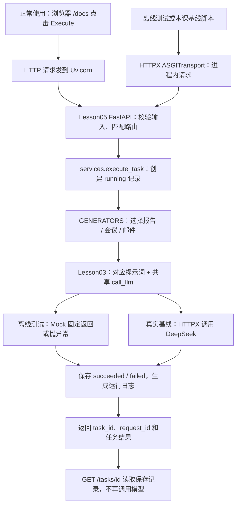

# C01 Lesson06：测试、最小基线与 C01 验收

状态：已完成学习；用户确认私下完成作业。2026-10-18补齐代码、参考答案与记录，并重新运行验收。

## 一、本课解决什么问题

Lesson05已能提交任务并读取当前进程内的结果。本课进一步要求：修改程序之后，怎样证明原来可用的行为仍然正常？模型返回的内容是否符合任务与事实边界？怎样记录证据，让下一次修改有可比较的起点？

区分三个层次：

| 层次 | 例子 | 证据 |
|---|---|---|
| 接口行为 | 不合法输入被拒绝；查不到任务返回404 | 离线自动化测试 |
| 任务执行 | 模型调用成功；失败记录可查询 | 任务状态、错误码、运行日志 |
| 内容质量 | 算对比例；不编造数据；不假装发信 | 真实输出与逐例内容评审 |

HTTP成功不等于任务执行成功。任务执行成功也不等于内容正确。

## 二、测试的Arrange / Act / Assert

Arrange准备输入与依赖，Act执行用户行为，Assert检查预期结果。

本课新增回归以“错误查询不破坏原任务”为目标。它不仅检查404，也检查错误查询前后原任务的完整内容相同。这种测试保护业务行为，不只是重复实现中的某行赋值。

```python

    async def test_missing_lookup_preserves_existing_task(self):
        """Lesson06 作业：查不到其他任务，不应破坏已保存记录。"""
        generate = Mock(return_value="已保存的报告提纲")
        with patch.dict(services.GENERATORS, {"report": generate}), \
             self.assertLogs(services.logger, level="INFO"):
            created = await self.call("POST", "/tasks", {
                "task_type": "report", "requirement": "准备报告",
            })
            self.assertEqual(created.status_code, 201)
            original = created.json()["task"]

            missing = await self.call("GET", "/tasks/not-exist")
            self.assertEqual(missing.status_code, 404)

            existing = await self.call("GET", "/tasks/" + original["task_id"])
            self.assertEqual(existing.status_code, 200)
            self.assertEqual(existing.json()["task"], original)
            self.assertEqual(len(store._tasks), 1)
            generate.assert_called_once_with("准备报告")
```

该方法位于现有Lesson05Tests类内。类已提供setUp清理、环境隔离和call方法，完整可运行文件见../tests/test_lesson05.py。

## 三、Mock与真实调用

Mock(return_value=...)用于固定输出；Mock(side_effect=...)用于抛出预期异常。

例如，模拟模型超时之后，测试应确认task.status=failed、错误码504且记录可查询。若这些断言都成立，测试就通过。它证明错误处理符合约定，不代表模型没有超时。

离线测试替代真实模型响应，不消耗模型额度，也不证明模型内容质量。日志中出现api.deepseek.com并不能单独证明真实请求，因为MockTransport也可以产生相同URL的HTTP日志。

## 四、浏览器、ASGI与Python代码的链条



ASGITransport只是把本地请求直接交给FastAPI应用，省去本地端口和Uvicorn。是否真实调用模型取决于有没有替换模型依赖。本课基线脚本没有替换模型，所以六例会真实调用DeepSeek。

VSCode用于编辑文件；执行代码的是你启动的Python进程。这里也没有后台队列，POST仍同步等待任务执行结束。

## 五、测试隔离

现有Lesson05Tests每项测试前清空store._tasks，并注册结束清理；通过patch.dict临时隔离环境变量。这样前一项测试的记录或本地Key不会影响下一项。

GENERATORS是执行任务时查找生成函数的映射，因此作业二patch该字典中的report项。仅替换另一个模块的同名变量，未必能影响已经放入字典中的函数引用。

```bash
conda activate fde
cd /Users/jace/office-agent-learning
python -B -m unittest discover -s tests -v
python -B -m unittest discover -s tests -p "test_lesson05.py" -v
```

本次全量31项全部通过。运行单个Lesson05文件为10项。FAIL一般是断言不成立；ERROR一般是测试中出现未处理异常，应看traceback定位，不能只看终端颜色。

## 六、为什么还需要真实六例基线

模拟测试可以证明“取到模型返回字符串后，程序会保存并返回它”，却不能证明这段字符串没有编造事实。

本课固定两例报告、两例会议、两例邮件。每例先定义输入与通过标准，再运行并保存输出。定义见../examples/lesson06/cases.json；采集代码见../examples/lesson06/run_baseline.py。

三维内容评审：

1. 任务符合度：是否完成用户要求的输出与计算。
2. 事实依据：是否仅使用已知事实，缺失内容是否标明待补。
3. 行动表述：是否声称执行了代码没有实现的动作，例如发送邮件或查库。

不能只凭出现“待补”就判通过，还要检查是否在其他地方编造事实。E02中“请直接发送”与当前能力边界冲突，应保留草稿并明确尚未发送。

R02中5/100=5%是给定数据上的计算；R01没有数据，不能生成“退款率5%”作为真实结论。

## 七、运行与记录真实基线

```bash
conda activate fde
cd /Users/jace/office-agent-learning
python -B -m examples.lesson06.run_baseline --output docs/C01-Lesson06-baseline-new-run.json
```

脚本使用现有fde、现有提示词和现有调用层，不修改.env，不安装依赖，不创建新服务器。输出含输入、检查标准、任务响应、查询核对、耗时、配置模型名称、代码commit及工作区状态、提示词哈希。每例结束即保存，不覆盖已存在的结果文件。

脚本不自动评审文本。运行后对新输出逐例评分，将执行成功数、查询一致数和内容通过数分别记录。不能把旧评分套到新模型输出上。

2026-10-18本轮六例全部执行成功、查询一致并通过内容评审。完整真实输出见本课基线JSON；逐例理由见基线Markdown。评审者为本次助手，未进行独立双人复评或统计置信区间估计。

## 八、基线与冻结评估集

当前六例可用于开发和回归，是开发验收集，不是独立冻结测试集。

记录代码版本时既要有commit，也要说明未提交修改；记录模型时沿用实际本地配置名，不写Key。本轮配置名为deepseek-flash，调用层未保留上游返回的实际模型标识，不推断具体内部版本。

失败与超时案例仍计入总分母。仅六例的一次全通过，不支持“真实场景100%可靠”的结论。

## 九、C01验收的边界

C01目前覆盖最小AI后端服务：输入验证、模型调用、模块分层、不同任务提示词、最小运行日志、内存任务记录及查询、自动回归与开发基线。

内存记录只属于当前Python进程；脚本退出后无法在另一个Uvicorn进程查询这些task_id。基线文件保存了本轮响应证据，并没有把业务任务存储改成数据库。

SQL、异步队列、状态恢复、RAG、工具执行、完整Tracing、鉴权与部署依然是后续内容。与已有约定冲突的行为是本课修复项；尚未教授的持久化能力是后续扩展。

## 十、作业与参考材料

四项作业依次是：运行并解释测试；增加一次404不破坏原任务的回归；执行与评审六例开发基线；整理C01验收文档。已按用户确认登记完成，并补齐此次检查证据。

完整答案见[C01-Lesson06-作业与答案.md](C01-Lesson06-作业与答案.md)。本课不另建api.py、services.py或单文件lesson06.py；新增测试和基线工具复用Lesson05应用。

下一模块按既定规划为C02 Transformer。先聊天上课，收到“同步到GitHub”后才提交上传。
